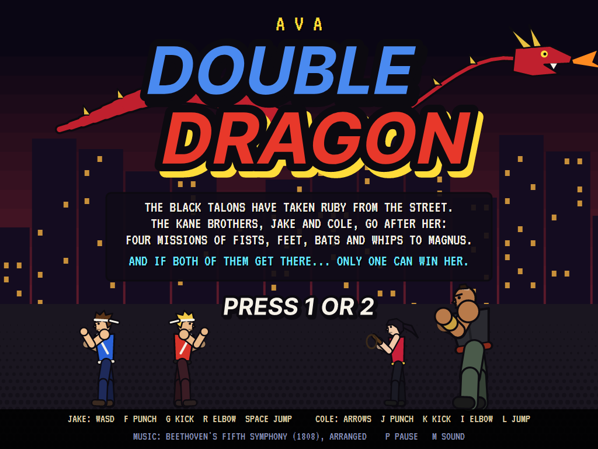
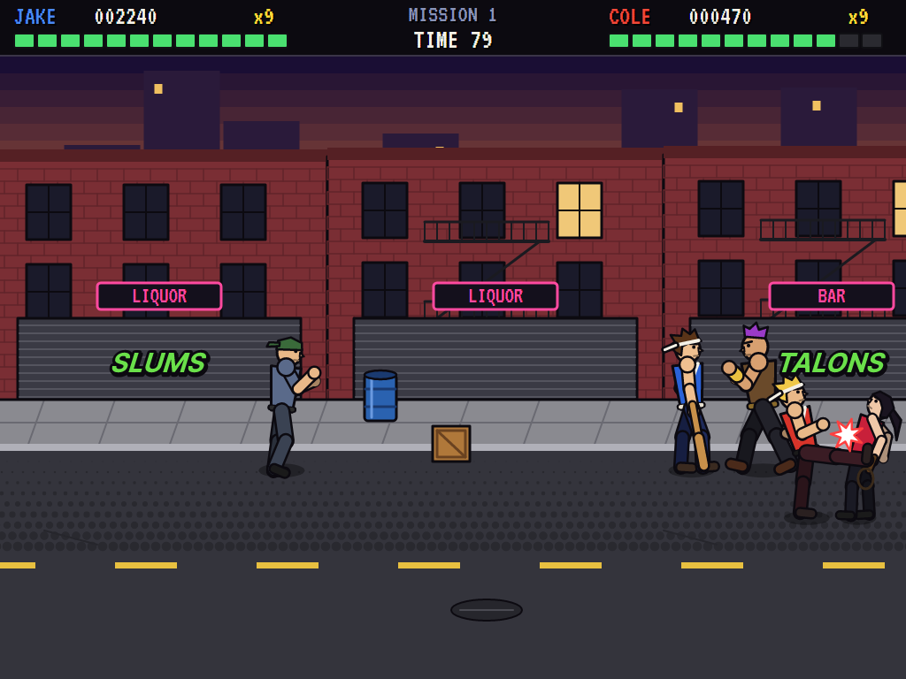
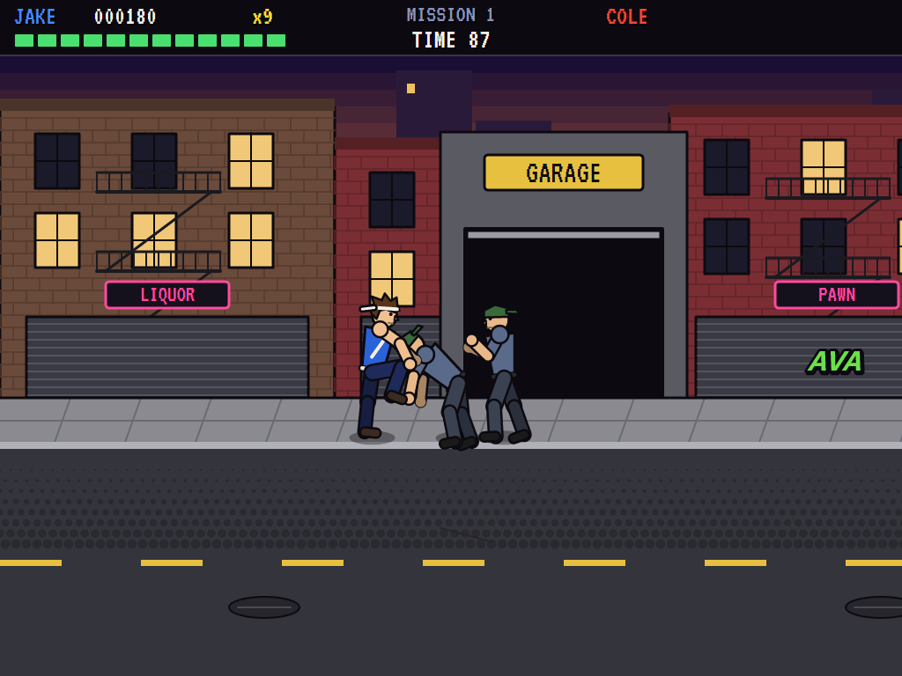
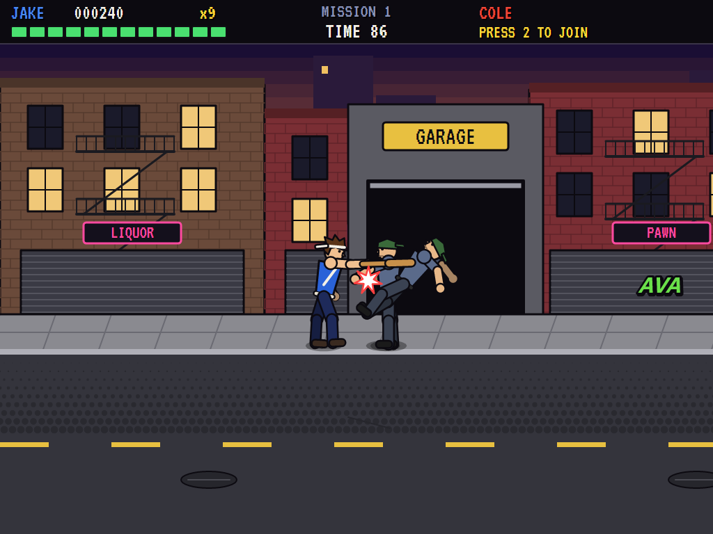
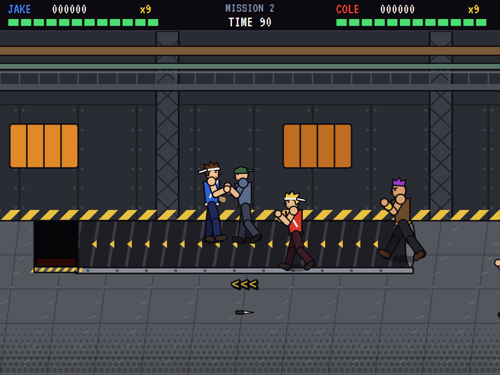
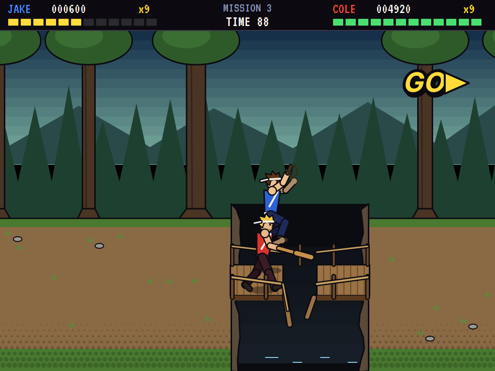
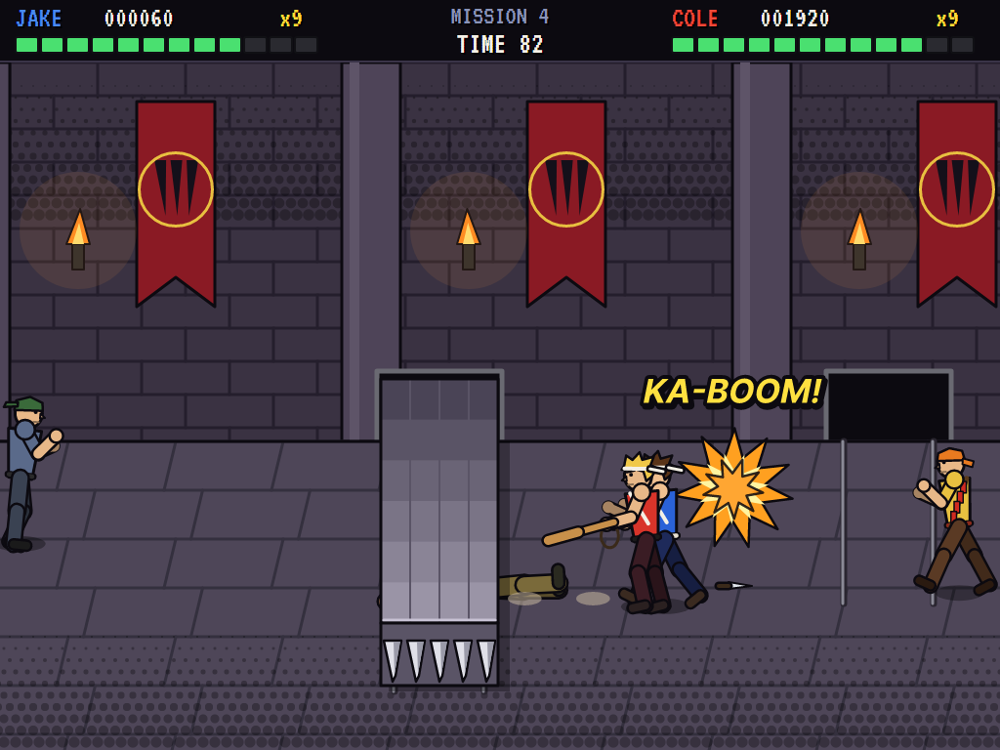
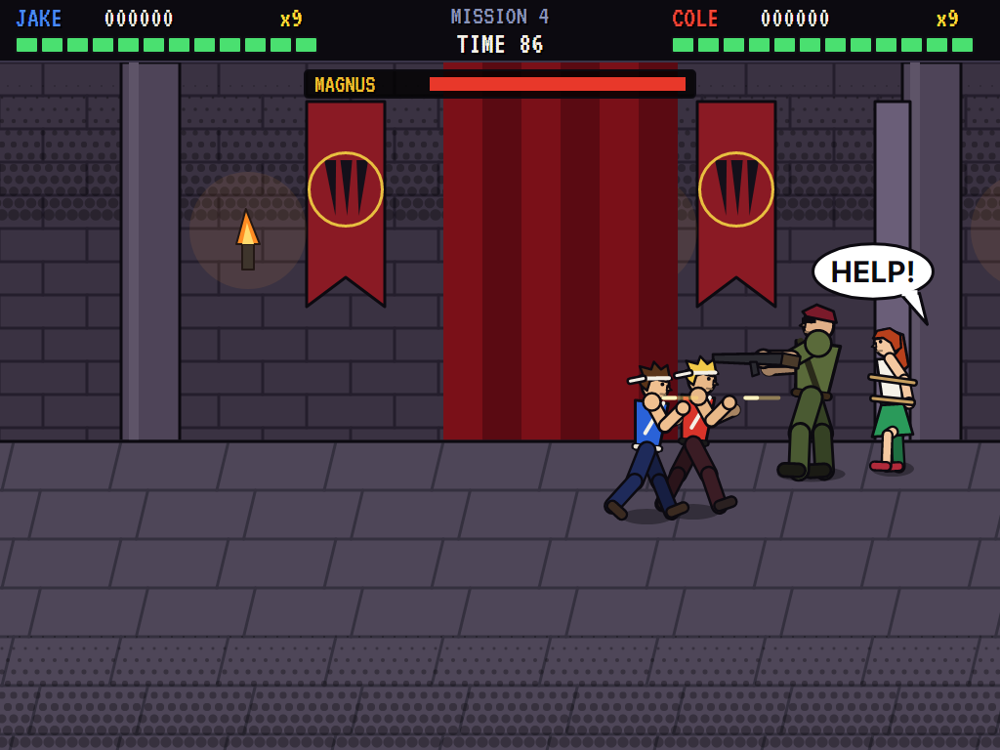
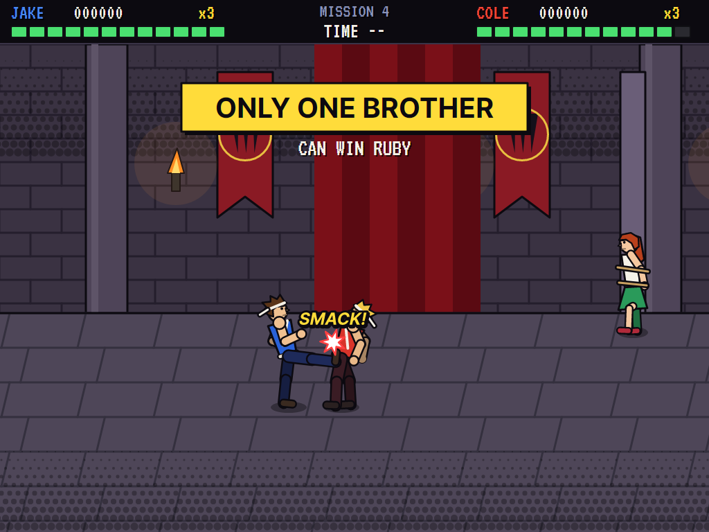
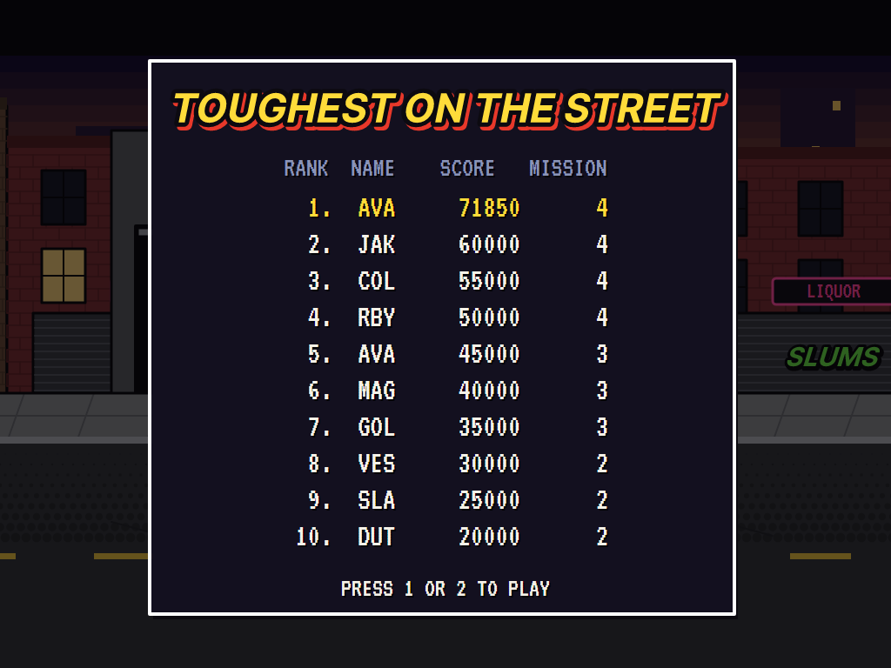

# AVA Double Dragon

[](https://github.com/Harlock123/AVADoubleDragon/actions/workflows/build.yml)

A belt-scrolling beat-'em-up in the style of Technōs Japan's 1987 arcade game **Double Dragon**, built with .NET 10
and Avalonia UI. The Black Talons gang have snatched Ruby off the street. The Kane brothers, Jake in blue and Cole in
red, go after her together: four missions of fists, feet, bats, whips, knives, oil drums and dynamite, through the
city slums, the gang's factory, the forest and their hideout, to the boss, Magnus, and his machine gun. And if both
brothers make it that far... only one of them can win her.

## Features

- **A street with depth.** Every mission is a floor band seen from the side and a little above: you walk along the
  street and up and down it, and everyone is drawn back to front. A blow only lands on someone on (about) your own
  line of the street, so stepping off a man's line is how you dodge him, and lining up is how you hit him.
- **Two brothers at once.** Jake and Cole fight side by side, each with his own health bar, lives and score, on one
  keyboard (keys that never overlap) or a gamepad each. Cole can join at any time by pressing 2, and a brother who
  runs out of lives can come back in, his score kept. The street only scrolls on as far as the trailing brother
  lets it. Brothers' blows pass each other by... until the end.
- **The moves.** Punch, kick, jump, and the jump kick in the air. The **back elbow** hits whoever is behind you
  (its own button, or kick with the stick held away from where you face). Three quick blows **daze** a man, bent
  double: walk into him and you **grab him by the hair**. Then kick for a **knee to the face** (the third knee floors
  him), punch for the **hair-pull** (yanked down and slammed face first into the street), or jump for the
  **over-the-shoulder throw**, which flattens anyone he lands on. A man **knocked down** lies a moment, gets up, and
  can't be hit again straight away; the same goes for the brothers.
- **Weapons**, picked up with a punch: a **baseball bat** (a sweeping knockdown), a **whip** (the longest reach of
  all), a **knife** (thrown, flat and fast along its line, then lying where it struck), **oil drums** and
  **crates** (lifted overhead and hurled down the line, bowling over everyone on it; crates break), and **dynamite**
  (lobbed, lit, and no respecter of sides). Get knocked down and you drop what you hold. The gang use them too.
- **The Black Talons**, each with a way of fighting: **Dutch**, the street punk, who walks up onto your line, fetches
  bats and knives, and grabs a dazed brother by the hair for knees and a throw (mash the buttons to break free);
  **Rooker**, the dock hand, who hurls drums and crates; **Vesper**, the whip woman, who lashes from beyond a
  fist's reach; **Slade**, the bald brawler, who dives in head first; **Fuse**, the demolition man, who keeps his
  distance and lobs dynamite; **Goliath**, the giant, who slaps you flat, charges along the line and is far too
  big to grab or daze; and **Magnus**, the boss, who lines up with a brother, takes aim (a red line shows it) and
  fires a burst along it. Step off the line.
- **Four missions**, each with its own hazard: **the city slums** (the gang pour out of their garage as its door
  rolls up), **the factory** (a conveyor belt carrying anyone on it to a pit, and a ladder up and out once the floor
  is clear), **the forest** (a gorge crossed by a bridge with a broken middle to jump; walk off it and you're gone,
  and so are the gang if you knock them in) and **the hideout** (spiked blocks that thrust out of the wall across
  the floor, some all the way, a stone guardian barring the boss's hall until the gang before it are beaten, and
  Magnus, with Ruby tied to a pillar behind him).
- **The ending.** Beat Magnus with both brothers still standing and they square up: their blows land on each
  other now, and the winner gets Ruby. A brother alone gets her without a fight.
- **The clock.** Each section of a mission has 90 seconds, set again every time a wave of the gang is beaten; it
  warns at 20, and running out costs every brother in the fight a life. Three lives each, and another every 30,000.
- **Scoring:** 10 for every point of harm a blow does; 500 for Dutch, 600 Rooker, 700 Vesper, 800 Fuse, 1,000
  Slade, 2,000 Goliath, 10,000 Magnus; 50 for each second left at a mission's end; 20,000 for winning Ruby.
- **The attract mode** shows the computer playing both brothers, then one, touring the missions. It lines up on
  the nearest of the gang and stands off at a kick's length, punches close and kicks a little further, elbows
  anyone behind it, grabs the dazed and knees them, jump-kicks the giants, steps off the line of bullets, charges and
  thrown drums, backs away from dynamite, waits out the spikes, jumps the bridge's gap, picks up bats and whips, and
  climbs the ladder. The two brothers pick different men and keep out of each other's way.

## Screenshots

| The title | Both brothers in the slums | A knee to the face |
|:---------:|:--------------------------:|:------------------:|
|  |  |  |
| | Cole kicks the whip woman; Jake has the bat. | Grabbed by the hair outside the garage. |

| The bat | The factory belt | The broken bridge |
|:-------:|:----------------:|:-----------------:|
|  |  |  |
| A punk goes flying. | Carried along towards the pit. | Jump the gap, or fall. |

| The spiked walls | Magnus | The duel |
|:----------------:|:------:|:--------:|
|  |  |  |
| A block thrust right across the floor; dynamite. | Off his line before he fires. | Only one brother can win Ruby. |

| The high scores |
|:---------------:|
|  |

The screenshots are made by the tests, which play the game in a real (headless) window; see
[Tests](#tests).

## Download and run

Ready-to-run builds for Windows, macOS and Linux, on both Intel/AMD and ARM, are on the
[Releases page](https://github.com/Harlock123/AVADoubleDragon/releases/tag/latest). **Latest build** is
rebuilt on every push to `main`. Each download is one self-contained executable: no .NET install is
needed.

| Platform | Archive |
|---|---|
| Windows | `AVADoubleDragon-win-x64.zip`, `AVADoubleDragon-win-x86.zip`, `AVADoubleDragon-win-arm64.zip` |
| macOS | `AVADoubleDragon-osx-arm64.tar.gz` (Apple silicon), `AVADoubleDragon-osx-x64.tar.gz` (Intel) |
| Linux | `AVADoubleDragon-linux-x64.tar.gz`, `AVADoubleDragon-linux-arm64.tar.gz`, `AVADoubleDragon-linux-arm.tar.gz` |

```bash
tar -xzf AVADoubleDragon-linux-x64.tar.gz     # or linux-arm64, linux-arm, osx-arm64, osx-x64
./AVADoubleDragon
```

On Windows, unzip and run `AVADoubleDragon.exe`. On macOS, if Gatekeeper refuses to open it, run
`xattr -d com.apple.quarantine AVADoubleDragon` once. Run with `--no-audio` for silence.

**Sound** comes through OpenAL Soft, built in for every platform. In a virtual machine the game
detects it and uses a larger audio buffer, so the sound doesn't break up.

**Gamepads** use SDL2, which is bundled for Windows, macOS and Intel/AMD Linux. ARM Linux builds need it
installed; without it the keyboard still works:

```bash
sudo apt install libsdl2-dev            # Debian / Ubuntu / Raspberry Pi OS
sudo pacman -S --needed sdl2-compat     # Arch / Omarchy
```

## Controls

| Action | Jake (keyboard) | Cole (keyboard) | Gamepad (one each) |
|---|---|---|---|
| Start / join / back in | Enter or 1 | 2 | Start |
| Walk along and up and down the street | W A S D | Arrow keys (or number pad 8 4 6 2) | Left stick / D-pad |
| Punch (and pick up, and throw what you hold) | F | J | X |
| Kick | G | K | B |
| Back elbow | R, or kick holding away | I, or kick holding away | Y |
| Jump (kick in the air for a jump kick) | Space or Left Shift | L, Right Shift or number pad 0 | A |
| Pause | P or Esc | P or Esc | Start (once in) |
| Sound on/off | M | | |
| Screenshot | Ctrl+S (to your Pictures folder) | | |

Walk into a dazed man to grab him by the hair; then kick to knee him, punch for the hair-pull, or jump (or attack
holding away) to throw him over your shoulder. Held yourself, mash the buttons to break free. On the high-score
table, type your initials, or use up/down and Space, then Enter.

## Tests

```bash
dotnet test AVADoubleDragon.slnx
```

The game runs in fixed 60 Hz steps, so it plays the same at any frame rate. Everything that changes lives in
one world that can be copied, and the tests check a copy plays out exactly the same. There are 64 tests. They
also check:

- **The street:** walking along it and up and down it, kept to the floor band, up the screen being up; a jump's
  height and reach.
- **The depth line:** a punch landing on the man on your line and not on one a step behind him; a kick reaching
  further than a punch; the elbow reaching behind where a punch doesn't (and kick-held-away being the elbow); the
  jump kick knocking down, and a jump going over a punch.
- **Grabs and throws:** three quick blows dazing; walking in grabbing by the hair, and the held man wrenching free
  if left; a dazed man hit again going down; three knees and he's down and let go; the over-the-shoulder throw
  landing behind and flattening whoever's there; the hair-pull slamming him down in front.
- **Knockdowns:** lying, getting up, and the moment no blow lands; the giants never dazed, never grabbed, floored by
  six quick blows.
- **Weapons:** the bat picked up, swung, and dropped when knocked down; the whip's reach, in the gang's hands and
  yours; a thrown knife flying along its line past a man off it; a drum bowling over everyone on its line; a crate
  breaking; dynamite lobbed lit and blowing up a man and the other brother, sparing the thrower; the gang fetching a
  bat, hurling a drum, lobbing dynamite.
- **The gang:** a punk walking onto your line and striking; a punk grabbing a dazed brother (kneed and thrown if
  left, free if he mashes); the whip woman striking from beyond a kick; the headbutt; the charge flattening one
  brother on its line and missing the other off it; the boss's burst hitting one brother and not the other;
  knockout points going to whoever did it.
- **The missions:** the gorge costing a life off the bridge and the jump clearing its gap; the gang knocked into it
  gone and scored; the spikes skewering the back of the floor and sparing the front (and the gang); the belt
  carrying a brother and a drum, and its pit; the ladder only once the factory floor is clear; the gang out of the
  garage; the statue barring the way, then sinking; the street stopping for each fight and the clock set again.
- **Two brothers and their lives:** Cole joining any time with his own lives and score; the brothers' blows passing
  each other by, until the duel; a life lost and a safe return; the game going on while either has a life, a brother
  coming back in with his score; an extra life every 30,000.
- **The clock and the end:** the warning and the time running out; the time bonus; the duel when both brothers stand
  at the end, and the winner getting Ruby; no duel for one brother; each brother's initials, best score first.
- **The game:** the demonstration (two brothers, then one), the high scores and the title; starting with 1 or 2 or a
  punch; pausing; both brothers' keys through the input handler, never overlapping, up going up the screen; a Shift
  let go as CapsLock still let go; every mission laid out fairly; every sound present.
- **The computer brothers:** one fighting through the slums; both fighting through all four missions to the duel,
  with one winning Ruby; and standing still mashing punch getting nowhere.

`tests/AVADoubleDragon.Tests/PilotProbe.cs` reports how the computer brothers get on, for tuning
(`DRAGON_PROBE=1` for one brother, `2` for both). One brother alone wins Ruby in seven and a half minutes of play,
losing two lives; both together reach the duel in seven minutes, losing a life each. `DRAGON_PROBE=mash` just
stands punching: the punks from the garage beat it down once, and the clock does the rest, without its ever leaving
the first screen.

The screenshot tests draw the real screen in a headless window. To refresh the README's pictures:

```bash
DRAGON_SHOTS=$PWD/Images dotnet test tests/AVADoubleDragon.Tests --filter ScreenshotTests
```

## Building

```bash
dotnet build AVADoubleDragon.slnx
dotnet run --project src/AVADoubleDragon
```

Needs the .NET 10 SDK. The sounds and music are made by `tools/make_sounds.py` (standard-library Python, with the
formant voice for the grunts, yells and the boss's laugh in `tools/speech.py`): `python3 tools/make_sounds.py`
rewrites `src/AVADoubleDragon/Sounds`.

## Project structure

```
AVADoubleDragon/
├── AVADoubleDragon.slnx
├── src/AVADoubleDragon/
│   ├── Engine/
│   │   ├── GameEngine.cs        # States, the missions' cards, the clears, the duel, the ending, joining in
│   │   ├── Sim.cs               # The brothers and their moves, blows and the depth line, grabs, throws,
│   │   │                        #   knockdowns, weapons, the belt, the spikes, the gorge, the scroll, the waves
│   │   ├── Sim.Foes.cs          # The Black Talons: how each of them fights, and the boss's gun
│   │   ├── Stage.cs             # The four missions: their waves, weapons and hazards
│   │   ├── World.cs             # The brothers, the gang and everything that changes, kept so it can be copied
│   │   ├── Pilot.cs             # The computer brother (the demonstration, and the tests)
│   │   ├── HighScoreTable.cs, InitialsEntry.cs
│   │   ├── InputHandler.cs, ControllerManager.cs  # Two players' keys, and an SDL2 gamepad each
│   │   └── SoundManager.cs      # Effects, voices and music through OpenAL
│   ├── Audio/                   # The OpenAL engine (from the author's AVABand)
│   ├── Views/GameCanvas*.cs     # The streets, the jointed fighters, the weapons, the title and the cards
│   └── Sounds/                  # The synthesised effects, voices and music
├── tests/AVADoubleDragon.Tests/  # Gameplay and screenshot tests, and the probe
├── tools/make_sounds.py, tools/speech.py
└── Images/                      # Screenshots
```

## About and licence

AVA Double Dragon © 2026 Lonnie Watson, under the [MIT License](LICENSE).

*Double Dragon* © 1987 Technōs Japan, now Arc System Works; the name *Double Dragon* belongs to its owner. AVA Double
Dragon is an independent, unofficial game in its style. Its characters, graphics, sounds and code are its own;
nothing is taken from the original game's program, graphics or sound. It is not affiliated with or endorsed by Arc
System Works or any other rights holder. The music is the opening of Ludwig van Beethoven's *Symphony No. 5 in C
minor* (1808), which is in the public domain, arranged here as street rock.
